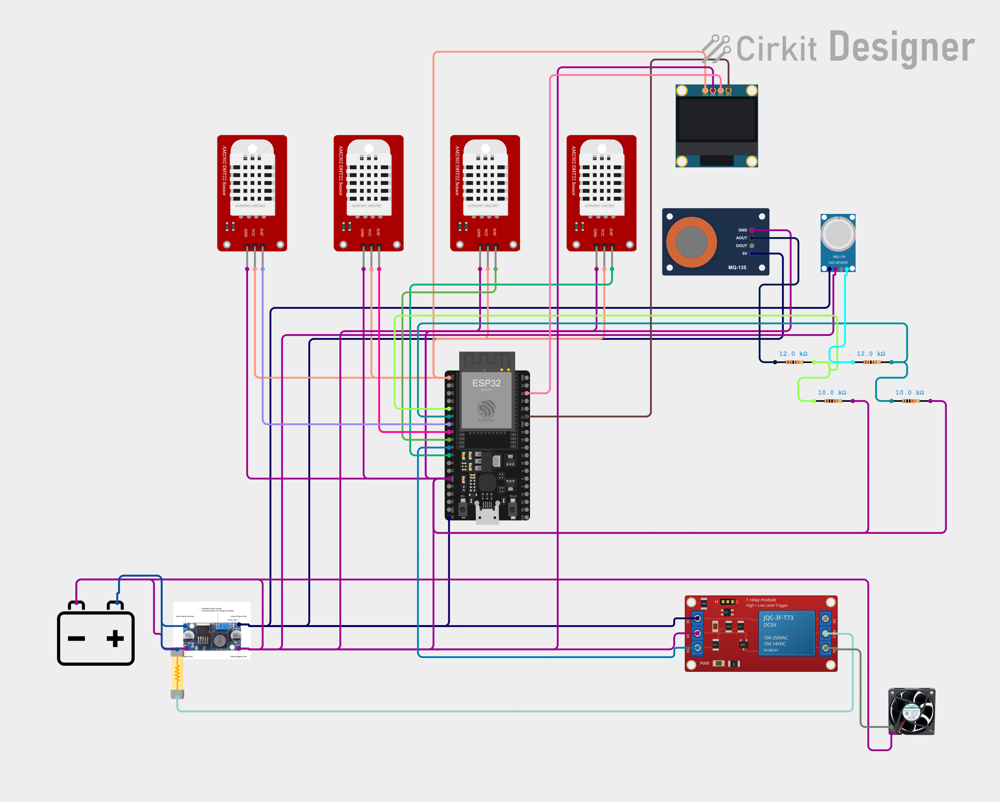

# Hardware: Kanda Rakshak

Two builds:
- **Part A — PoC (bench):** what we build and test now, ₹11,500.
- **Part B — Field kit v2:** for a real 25 t chawl, ≈₹17,000 (≈₹700/t). Designed, not built.

All prices are **approximate, Nov 2026** (retail, Pune / online). Recheck when ordering.

Owner: Sarvejeet. Reviewer: `hardware-safety-reviewer` agent + a second human before first power-on.
Pin truth: `firmware/include/config.h`. This file must match it.

> **Safety first.** 12 V won't hurt you, but one wrong jumper can kill the ESP32, and thin wire carrying too much current gets hot. Never connect or move wires with the power on. Always measure the buck output before connecting anything to it.

---

# Part A — PoC (bench build, ₹11,500)



`wiring-poc.png` (Cirkit Designer export, final PoC circuit, 5 Nov 2026).

**What the diagram shows (checked against this file on 5 Nov 2026):** DHT22 DAT → GPIO 32 / 33 / 25 / 27 with VCC on 3V3; MQ-135 / MQ-136 AOUT → 12 kΩ → node → 10 kΩ → GND, nodes → GPIO 34 / 35; relay IN → GPIO 26, relay DC+ and MQ 5V from the LM2596 output rail, ESP32 fed on its 5V pin; COM fed from 12 V + through a fuse, NO → fan +; OLED SDA 21 / SCL 22 on 3V3; one common ground.

**Where the diagram differs from this file (this file is the build truth):**
- The 12 V source is drawn as a **battery**; on the bench we use the 12 V 2 A adapter. Wiring is the same.
- **One fuse is drawn**, on the fan path (12 V + → relay COM), with no value. Fit **1 A slow-blow** there.
- **Main 2 A fuse not drawn.** In the drawing the buck IN+ goes straight to 12 V +. Fit the 2 A fuse at adapter/battery + so it feeds everything, buck included.
- **Flyback diode not drawn** (1N4007 / 1N5819 across the fan, stripe to fan +).
- **10 kΩ pull-down on relay IN not drawn.**
- Relay trigger jumper position is not shown; it must be on **H**.
- The drawing does not label which DHT22 is TOP / MID / BOT / AMB. Use the pin map in §A4 and the B1 breath test.
- Optional SCD41, BME688 and DS18B20 are not drawn.

**Diagram TODO:** redraw with the 2 A main fuse, the 1 A value on the fan fuse, the flyback diode, the 10 kΩ pull-down, the jumper on H and the DHT position labels.

## A1. Summary

| Block | Connection |
|---|---|
| Controller | ESP32 DevKit V1 (ESP32-WROOM-32) |
| 4 × DHT22 | DAT → **GPIO 32** (heap TOP), **33** (MID), **25** (BOT), **27** (AMBIENT). VCC → **3V3**, GND → GND |
| MQ-135 / MQ-136 | VCC → 5 V rail. AOUT → **12 kΩ** → divider node → **10 kΩ** → GND. Divider node → **GPIO 34** (MQ-135) / **GPIO 35** (MQ-136). Max at pin: 5.0 V × 10/22 = **2.27 V** |
| Fan relay | Relay module (JQC-3F-T73, 5 V coil, trigger jumper on **H**). IN ← **GPIO 26** (HIGH = fan ON), **10 kΩ pull-down IN → GND**. DC+ → 5 V rail, DC− → GND |
| Fan path | 12 V + → **1 A slow-blow fuse** → relay **COM**; relay **NO** → fan +; fan − → 12 V −. **22 AWG** wire on this path. **Flyback diode 1N4007 (or 1N5819)** across the fan, stripe/cathode to fan + |
| Power | 12 V adapter + → **main 2 A fuse** → everything (buck and fan path). LM2596 12 V → **5.0 V rail**, which feeds ESP32 5V/VIN, MQ heaters and the relay module |
| OLED (SSD1306, I2C) | SDA → **GPIO 21**, SCL → **GPIO 22**, VCC → 3V3 |
| Ground | **One common ground**: adapter −, buck −, ESP32 GND, sensors, relay DC− |
| Optional | SCD41 (CO₂) + BME688 (VOC/sulphur) on the same I2C bus (21/22). DS18B20 string on **GPIO 4** with a **4.7 kΩ pull-up to 3V3** |

> **Real build:** the main 2 A fuse moves to the **battery +** terminal, so the battery lead is protected too.

## A2. Bill of materials (1 PoC kit)

Budget: **₹11,500** = kit ₹7,910 + testing ₹3,590 (see `docs/PROJECT_INSTRUCTIONS.md`). Fill the per-line prices from the purchase receipts. Don't invent them.

| # | Part | Qty | Notes |
|---|---|---|---|
| 1 | ESP32 DevKit V1 (ESP32-WROOM-32) | 1 | Check the USB chip (CP2102 / CH340) and install its driver |
| 2 | DHT22 / AM2302 **module** (3-pin, pull-up on board) | 4 | 3 in the heap + 1 ambient |
| 3 | MQ-135 gas sensor module | 1 | VOC / NH₃ |
| 4 | MQ-136 gas sensor module | 1 | H₂S / sulphur (cut list item 1) |
| 5 | 1-channel 5 V relay module (JQC-3F-T73, H/L jumper) | 1 | Jumper on **H**. Must pass bench test B9 at 3.3 V logic |
| 6 | 12 V DC fan, 80–120 mm, ≤ 0.3 A | 1 | |
| 7 | **Diode 1N4007 (or 1N5819)** | 1 | Flyback across the fan, stripe to fan + |
| 8 | **Fuse 1 A slow-blow + inline holder** | 1 | Fan path, at relay COM |
| 9 | **Fuse 2 A + inline holder** | 1 | Main fuse at adapter/battery +, feeds everything |
| 10 | **22 AWG wire**, red + black, 2 m | 1 | 12 V fan path |
| 11 | 12 V 2 A DC adapter + female barrel jack with screw terminals | 1 | |
| 12 | LM2596 buck module | 1 | Set to 5.0 V **before** connecting anything |
| 13 | Resistors: **12 kΩ ×2, 10 kΩ ×3** | — | MQ dividers (12k + 10k each) + **10 kΩ relay IN pull-down** |
| 14 | 0.96" SSD1306 I2C OLED | 1 | Local status display |
| 15 | Breadboard 830 + jumpers (M-M, M-F) | 1 set | Signal wiring only; the fan current goes on 22 AWG |
| 16 | 3-core wire 3 m + heat-shrink, 20 mm PVC pipe + caps | — | Probe sticks |
| 17 | Enclosure for the electronics | 1 | Closed: covers the relay's 12 V screw terminals |
| 18 | Ventilated crates ×2 + 4 kg onions | — | Fresh crate + rot crate |
| 19 | Multimeter | 1 | Mandatory |
| opt | SCD41, BME688, DS18B20 string + 4.7 kΩ | — | Optional, toward the v2 sensors |

## A3. Power budget

| Load | Rail | Current |
|---|---|---|
| ESP32, WiFi transmitting (peak) | 5 V | ~250 mA |
| MQ-135 heater | 5 V | ~160 mA |
| MQ-136 heater | 5 V | ~180 mA |
| Relay coil | 5 V | ~75 mA |
| DHT22 ×4 + OLED | 3.3 V (ESP32 regulator) | ~30 mA |
| **5 V rail total** | | **≈ 0.7 A** (LM2596 rated 3 A → OK) |
| Buck input at 12 V (≈ 85 % efficient) | 12 V | ≈ 0.35 A |
| Fan | 12 V | ≤ 0.3 A |
| **12 V total** | | **≈ 0.65 A** → main 2 A fuse, 2 A adapter |

## A4. Pin map (must match `firmware/include/config.h`)

| Function | Part pin | ESP32 pin | Why this pin |
|---|---|---|---|
| Heap TOP temp/RH | DHT22 #1 DAT | **GPIO 32** | General GPIO, no strapping role |
| Heap MIDDLE temp/RH | DHT22 #2 DAT | **GPIO 33** | General GPIO |
| Heap BOTTOM temp/RH | DHT22 #3 DAT | **GPIO 25** | Digital use only (ADC2 is fine as digital with WiFi on) |
| AMBIENT temp/RH | DHT22 #4 DAT | **GPIO 27** | Digital use only (ADC2) |
| VOC gas | MQ-135 AOUT → divider | **GPIO 34** (ADC1) | ADC1 works with WiFi on; input-only |
| Sulphur gas | MQ-136 AOUT → divider | **GPIO 35** (ADC1) | ADC1, input-only |
| Fan relay | Relay IN | **GPIO 26** | Not a strapping pin, no boot output. 10 kΩ pull-down keeps the fan OFF during boot |
| OLED / I2C | SDA / SCL | **GPIO 21 / 22** | Default I2C pins |
| DS18B20 (optional) | DQ | **GPIO 4** | 4.7 kΩ pull-up to 3V3 |
| Status LED | Onboard | **GPIO 2** | Built in |

**Do not use:** GPIO 0, 2 (except the LED), 5, 12, 15 (boot strapping), GPIO 6–11 (flash), or ADC2 pins for **analog** while WiFi is on.

### MQ voltage divider
```
MQ AOUT ──[12 kΩ]──┬──> ESP32 GPIO 34 (or 35)
                   │
                [10 kΩ]
                   │
                  GND
Vpin = Vout × 10/(12+10) = 0.455 × Vout  → 5.0 V becomes 2.27 V
```
The firmware multiplies by `MQ_DIVIDER_RATIO = 2.2` ((12k + 10k) / 10k) to report the sensor's real output voltage.

## A5. Build order (test each block before adding the next)

### Step A — ESP32 alone (USB power only)
1. `cd firmware && pio run -t upload && pio device monitor`.
2. You should see the boot banner and `[WARN] DHT top: NaN` (no sensors yet). The onboard LED blinks.

### Step B — Power rail (ESP32 NOT connected)
1. 12 V adapter + → **2 A fuse** → barrel jack → buck IN+. Adapter − → buck IN−.
2. Multimeter on buck OUT. Turn the screw until it reads **5.00–5.05 V**, then mark the screw.
3. Power off. Buck OUT+ → **5 V rail**, OUT− → **GND rail**. Adapter − also to the GND rail. **All grounds common.**

### Step C — DHT22 ×4 (USB power is enough)
1. Each module: `+` → **3V3**, `−` → **GND**, `DAT` → GPIO 32 / 33 / 25 / 27 (§A4).
2. Label each sensor with tape: TOP, MID, BOT, AMB.
3. Breathe on one: only its RH jumps. That proves the label → pin mapping (test B1).

### Step D — MQ sensors (needs the 5 V rail)
1. Power off. MQ VCC → **5 V rail**, GND → **GND**, AOUT → **12 kΩ** → node → **10 kΩ** → GND. Leave DOUT unconnected.
2. **Before** connecting the node to the ESP32, measure it: it must stay **below 2.5 V** (expected max 2.27 V).
3. Node → GPIO 34 (MQ-135) / GPIO 35 (MQ-136). ESP32 GND → GND rail.
4. **USB and the rail must never feed the ESP32 5V pin at the same time.** For any test that uses the serial monitor (Steps C–E, bench tests B1–B10): leave the ESP32 **5V pin disconnected from the rail** and power the ESP32 from USB. The rail still feeds the MQ heaters and the relay, and the grounds stay common. Connect ESP32 5V → rail only for standalone runs with USB unplugged.
5. **Burn-in:** new MQ sensors need 24–48 h powered before readings settle. The firmware also ignores gas for `MQ_WARMUP_MS` after every boot.

### Step E — Fan via relay
1. Power off. Relay module: DC+ → **5 V rail**, DC− → **GND**, IN → **GPIO 26**, **10 kΩ from IN to GND**. Trigger jumper on **H**.
2. Fan path on **22 AWG**: 12 V + (after the main fuse) → **1 A slow-blow fuse** → relay **COM**; relay **NO** → fan red (+); fan black (−) → 12 V −. Leave NC unconnected.
3. **Flyback diode** at the fan: 1N4007 (or 1N5819), **stripe/cathode to fan +**, other end to fan −.
4. Power on. The fan must stay **OFF** through boot and reset (test B10).
5. In the serial monitor type `fan on` / `fan off` / `fan auto`. The relay clicks and the fan follows. If the relay doesn't switch reliably at 3.3 V logic, see test B9.

### Step F — WiFi + backend
1. Fill `firmware/include/secrets.h`: WiFi, `API_BASE` = `http://<laptop-LAN-IP>:8000`, device id `KR-01`, token = `DEVICE_TOKEN` from `backend/.env`.
2. Laptop and ESP32 on the same WiFi. The serial monitor shows `[HTTP] 200` every cycle, and the dashboard shows KR-01 live.

## A6. Mini-chawl assembly

```
                 ┌──────────── ELECTRONICS BOX (closed, outside, above crate) ──────┐
                 │  ESP32  buck  relay  fuses  OLED        ← 12 V adapter cable      │
                 └───┬───────┬───────┬───────────┬──────────────────────────────────┘
       AMB DHT22 ●   │ probe │ gas   │           │ fan cable (22 AWG)
  (outside, shaded)  │ stick │ pod   │           ▼
          ┌──────────┼───────┼───────┼─────┐  ┌──────┐
          │  GAS POD ●(MQ-135/136, top, ───┼──│ FAN  │ blows outside air
          │          │  away from fan)     │  │ 12 V │ through the slats
          │   ●TOP DHT22  ← 10 cm below top │  └──────┘
          │   ●MID DHT22  ← middle of heap  │
          │   ●BOT DHT22  ← 5 cm above floor│   ONION CRATE (ventilated)
          └─────────────────────────────────┘
```
- Gas pod on top of the heap (the gases rise), shielded from the fan airflow.
- Ambient DHT22 outside the crate, in shade, not in the fan's exhaust.
- The electronics box never goes inside the heap (moisture, and onion skins burn).

## A7. Code ↔ hardware

| Event | Where | Code |
|---|---|---|
| Read 4 × DHT22 every 30 s | ESP32 | `firmware/src/main.cpp` → `readDhtAll()` |
| Read MQ mV (×`MQ_DIVIDER_RATIO`) | ESP32 | `readGasMv()` |
| Fan ON/OFF, offline | ESP32 | `decideFan()` → GPIO 26 HIGH/LOW |
| Send JSON / buffer offline | ESP32 → backend | `postReading()`, ring buffer `queue[]` |
| Rot-risk, price, advice, notify | backend | `rotrisk.py`, `price.py`, `advisory.py`, `notify.py` |

## A8. Common faults

| Symptom | Likely cause | Fix |
|---|---|---|
| ESP32 not detected | Charge-only cable / missing driver | Use a data cable; install the CP210x / CH340 driver |
| DHT reads NaN | Wrong pin / loose jumper | Check §A4; wait ≥ 2 s between reads |
| Gas always 0 | Divider open | Measure the divider node |
| Gas node > 2.5 V | Resistors swapped (10k on top) | **Power off**, fit 12k on top, 10k to GND |
| Fan clicks on at boot | Pull-down missing | Fit 10 kΩ from IN to GND |
| Relay won't switch from GPIO | Module needs > 3.3 V logic | See B9: transistor driver or a 3.3 V-trigger module |
| ESP32 resets when the fan starts | Brown-out / no flyback diode | Check the diode; add 470–1000 µF across the 5 V rail |
| Fuse blows | Short on the fan path / fan stalled | Find the fault. Never upsize the fuse |

---

# Part B — Field kit v2 (25 t chawl, ≈₹17,000, ≈₹700/t)

Status: **designed, not built.** Prices approximate, Nov 2026.

| Block | Part | Notes |
|---|---|---|
| Controller | ESP32-C3 or ESP32-S3 | See the pin note below |
| Heap temp/RH | **4 × SHT40** with **PTFE membrane caps**, via **TCA9548A** I2C mux | The SHT40s share one I2C address, so the mux gives each its own channel. PTFE keeps dust and condensation off the sensor |
| Heap core temperature | **DS18B20 string** (one-wire, 4.7 kΩ pull-up) | Several probes down the heap for heat spots (ΔT) |
| CO₂ | **SCD41** (I2C) | Respiration rise during fan-off windows |
| Sulphur / VOC | **BME688** (I2C) | Tells rot from sprouting. **MQ-136** is an option where there is grid power (heater draw) |
| Fans | **2–3 × 300 mm** fans blowing into an **under-floor plenum** | Switched by SSR / logic-level MOSFET on two outputs. Sizing target 1–2 m³/min of air per m³ of onions (see EVIDENCE.md) |
| Network | **A7670C** 4G/2G modem on UART2 | **Its own 4 V / 2 A buck** (2 A transmit bursts); never powered from the 3.3 V or 5 V logic rail |
| Power | Fans on **grid**; **10–20 W solar** + battery for the electronics | Through a power cut, the electronics keep sensing, logging and deciding. The **fans can't run** until the grid returns. Main fuse at **battery +** |

**Mains safety (open decision: fan voltage).** A grid-powered 300 mm fan is usually **230 V AC**, and that means mains in a damp shed, which v1 avoided (see TECH_STACK.md). Choose one before building:
- **12/24 V DC fans** from a grid power supply (keeps mains out of the shed), or
- **230 V AC fans**, installed by a licensed electrician, with: a 30 mA RCD/RCCB, a proper earth, a correctly rated SSR with its own fuse, an IP65 enclosure for every mains part, and no mains wiring inside the heap.
This must pass `hardware-safety-reviewer` and a human electrician before any field install.

**Pin note (do not wire from this yet).** The v2 design was sketched on classic-ESP32 numbering: fan outputs **GPIO 26 / 19**, modem **UART2 TX/RX GPIO 17 / 16**. These numbers don't carry over to C3/S3. On most S3 modules GPIO 26 is flash/PSRAM and GPIO 19 is USB D−. On the C3, GPIO 16/17 are flash pins. Make a final pin map for the chosen chip, pass it through `hardware-safety-reviewer`, and put it in `config.h` before any PCB or wiring.

### Cost scaling (approximate, Nov 2026)

| Chawl size | Kit cost | Per tonne |
|---|---|---|
| 5 t | ≈ ₹9–10k | ≈ ₹1,800–2,000/t |
| **25 t** | **≈ ₹16–19k (design point ≈ ₹17,000)** | **≈ ₹700/t** |
| 100 t | ≈ ₹45–65k | ≈ ₹450–650/t |

Fans and plenum scale with tonnage; the controller, sensors and modem cost about the same at any size.
